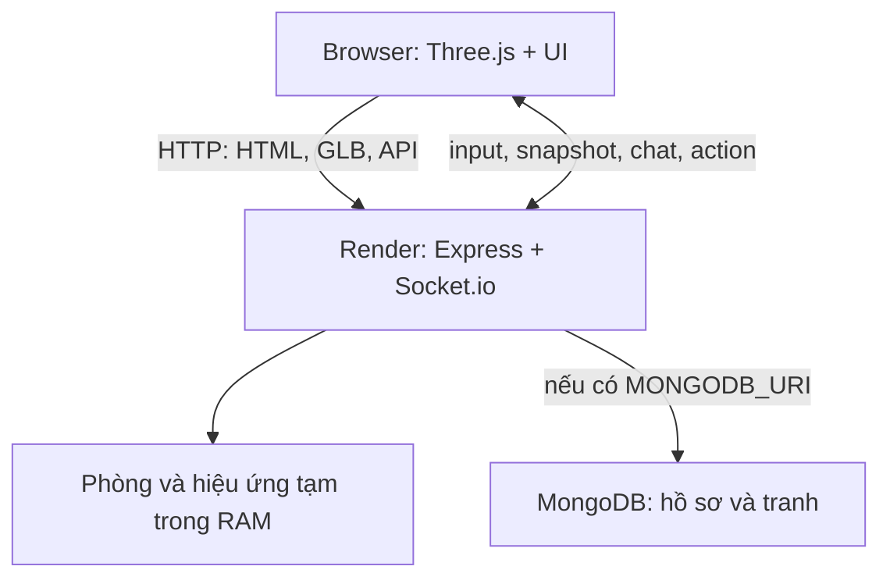

# Kiến trúc Nova Pagoda

## Một địa chỉ, một tiến trình Node

Browser tải `client/index.html` từ Express, nhận Three.js từ `/vendor/three` và addons từ `/vendor/addons`. Import map không phụ thuộc CDN. Socket.io gắn vào cùng HTTP server nên trên Render không cần service frontend riêng, không hardcode hostname và tránh cấu hình CORS hai domain.

## Trách nhiệm từng phần

| File | Trách nhiệm |
| --- | --- |
| `server.js` | HTTP, xác minh hồ sơ và mật khẩu vai, handshake, phòng, tick mô phỏng, chat, nghi thức, ảnh |
| `server/auth.js` | HMAC token có hạn, lọc chữ, so sánh mã bí mật |
| `server/store.js` | MongoDB hoặc bộ nhớ tạm; cập nhật xu bằng điều kiện đủ tiền |
| `shared/world.js` | Cùng vị trí, collider, tốc độ, danh mục vai/áo ở client và server |
| `client/js/app.js` | Tạo renderer/scene/camera, nhập liệu, dự đoán di chuyển, socket và menu |
| `client/js/world.js` | Dựng công trình, cây, hoa, hồ, cá, tranh, nạp tượng quét |
| `client/js/avatar.js` | Clone skin/rig, áp trang phục, phụ kiện, particles |
| `client/js/animations.js` | Clip GLB, mixer, crossfade, LoopOnce/LoopRepeat, đồng bộ phase |
| `client/js/bubble-chat.js` | Chiếu vị trí đầu qua camera để đặt overlay |
| `client/js/rituals.js` | Dựng/huỷ hiệu ứng có TTL; hoạt cảnh dựa thời gian và seed |

## Vào phòng và vai Trụ trì

1. Client tạo guest key ngẫu nhiên 256 bit và giữ trong localStorage. Đây là hồ sơ khách của trình duyệt, không phải tài khoản email.
2. `POST /api/profile` gửi tên, vai, áo, guest key. Nếu vai `abbot`, phải gửi mật khẩu khớp `ABBOT_PASSWORD` của máy chủ.
3. Máy chủ lọc tên, kiểm tra kết hợp vai/áo, lưu hash guest key, cấp token HMAC. Mật khẩu không nằm trong gói JavaScript và không được trả về profile/snapshot.
4. Socket handshake đưa token; máy chủ xác minh chữ ký, hạn và hồ sơ.
5. `join` tạo mã phòng 6 ký tự hoặc dùng mã mời. Snapshot/chat/động tác/ritual chỉ phát tới phòng đó. Profile không được xuất hiện đồng thời ở hai socket; tab mới thay tab cũ.
6. File `.env.example` là hướng dẫn cấu hình server, không phải cách nhúng mật khẩu vào client. Trên production dùng Environment của Render.

Quyền `ADMIN_TOKEN` thay tranh tách khỏi vai Trụ trì. Trụ trì là vai trình bày/avatar; game không cấp quyền chạy lệnh máy chủ hay sửa user khác.

## Đồng bộ chuyển động

- Client gửi **hướng nhập** `{dx,dz,run}` khoảng 16 lần/giây, không có quyền gửi tọa độ tuyệt đối để server áp dụng.
- Server mô phỏng bước cố định 50 ms (20 Hz), chuẩn hóa vector và kiểm tra collider. Cả hai phía dùng `movePosition()` để trượt dọc tường.
- Mỗi 100 ms (10 Hz), server gửi `snapshot` cho từng phòng: tọa độ/hướng/hành động/thời điểm.
- Client dự đoán vị trí bản thân để phím phản hồi ngay; sau snapshot hiệu chỉnh sai lệch. Người khác được nội suy theo hướng/điểm đích.
- Sau 900 ms không có input mới, server dừng hướng nhập. Blur/ẩn trang và mở modal cũng dừng input ở client.
- `actionAt` cùng `serverNow` giúp người vào muộn phát đúng khoảng thời gian của animation. Server khóa chu trình lạy và tự trả về Idle khi hết thời gian.

Mã không có rollback lịch sử đầy đủ, lag compensation thi đấu hoặc chống gian lận cấp game cạnh tranh. Không nhận tọa độ tùy ý đã ngăn kiểu dịch chuyển đơn giản qua packet.

## Protocol

| Chiều | Event/route | Payload chính |
| --- | --- | --- |
| Client → HTTP | `POST /api/profile` | guestKey, name, role, outfit, abbotPassword khi cần |
| Client → socket | `join` | room hoặc chuỗi trống; có ack |
| Client → socket | `input` | dx, dz, run |
| Client → socket | `action` | action hợp lệ |
| Client → socket | `chat` | text tối đa 240 ký tự |
| Client → socket | `interact` | bell/drum/vending + product |
| Client → socket | `ritual` | incense/lantern/fortune + wish tối đa 100 ký tự |
| Server → phòng | `snapshot`, `roster` | players; snapshot có at |
| Server → phòng | `action` | id, action, at |
| Server → phòng | `chat` | id, name, text, at |
| Server → phòng | `ritual` | id, seed, kind, x, z, at, expiresAt, by, wish |
| HTTP | `GET /health` | ok, persistence |
| HTTP | `GET /api/config` | durable, maxPlayers, version |
| HTTP admin | `POST /api/paintings/:slot` | Bearer token + X-Admin-Token + image multipart |

Các event có mutation dùng ack `{ok:true}` hoặc `{error:'...'}`. Input và broadcast không cần ack. Rate limit áp dụng API, nhập vai, chat và nghi thức.

## Hoa đăng và làn khói

Server xác minh người chơi ở gần landmark, sinh seed/thời điểm, lưu tối đa 48 sự kiện hiệu ứng còn hạn/phòng. Người vào sau nhận lại các sự kiện còn sống. Client tính tuổi hiệu ứng từ thời gian server, không tích lũy sai số bằng cách tự đẩy đèn mỗi frame.

Hoa đăng sống 90 giây, khói hương 45 giây; mesh/material bị dispose khi hết hạn hoặc đổi phòng. Khi server restart, hiệu ứng biến mất. Rút thẻ chỉ gửi kết quả về người rút; tám lời nhắc do dự án tự biên soạn.

## Tranh

Mảng `client/data/paintings.js` có thể chỉ đến file repo hoặc URL HTTPS. Tranh tải bằng TextureLoader, sRGB, giữ tranh dự phòng khi URL lỗi. Ảnh ở domain khác cần CORS. Có thể thêm slot với tọa độ/kích thước/góc xoay.

UI upload hỗ trợ hai slot trái/phải. Backend Multer giới hạn 3 MiB, Sharp kiểm tra nội dung JPEG/PNG/WebP, giới hạn 32 MP, xoay đúng hướng rồi cắt `768×1024`. Ảnh lưu MongoDB hoặc RAM; không ghi ổ đĩa Render. Sự kiện cập nhật tranh phát cho mọi phòng vì tranh là cấu hình chung.

## Hiệu năng và mở rộng

- Mái, cây, hoa và các mesh tĩnh gộp theo material; tượng tự dựng gộp riêng để có thể ẩn khi thay model.
- Avatar tải một lần cho mỗi URL, dùng geometry chung, clone skeleton và material theo người chơi. GLB gốc khoảng 595 KiB.
- Tượng quét ~98.601 triangles, GLB khoảng 1,69 MiB sau gộp đỉnh/chuẩn hóa. Đây là asset nặng nhất; có thể giảm lưới bằng Blender và thay URL config nếu muốn.
- Một đèn mặt trời có bóng, HemisphereLight bổ sung. Không có chuỗi hậu kỳ nặng hay mỗi đèn hoa đăng một PointLight.
- Màn hình cảm ứng giới hạn DPR 1,35 và tắt bóng động; desktop DPR tối đa 1,75. Cá bơi theo ellipse, không mô phỏng vật lý nước.
- 24 chỗ/phòng là cap logic. Chưa đo CPU/băng thông/FPS với đủ 24 thiết bị thật.

Muốn nhiều Node instances: phải thiết kế room affinity và authority mỗi phòng (hoặc tiến trình room owner), sticky sessions cho long-polling, Redis adapter để chuyển event và persistence chung. Chỉ thêm Redis adapter không tự đồng bộ Map `players` giữa các server. Bản bàn giao triển khai một instance, không tự cấu hình autoscaling.
